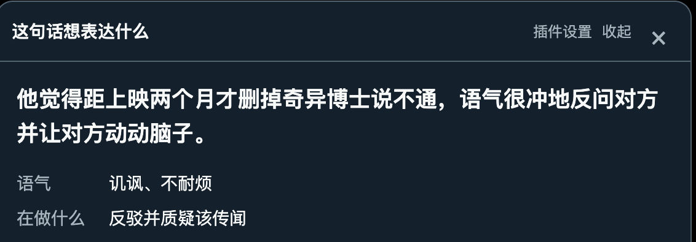

# Meaning Check

Understand the meaning, tone and evidence behind public posts and replies. Bring your own model API and click **Identify intent**. The interpretation opens directly under the source text.

**Open source · MIT · Your API (BYOK) · Chinese / English interface**

[中文](README.md) · [Product rules](documentation/product.md) · [Models and APIs](documentation/models.md) · [Verification](documentation/tests.md)

## What it does

- Interpret standalone posts directly. For replies, use the current text, its direct parent and the thread root, deduplicating shared sources.
- Show a concrete reading in short everyday sentences, then brief tone and communicative function. Expand original evidence and background when needed. Disagreement does not automatically mean hostility; no invented confidence percentages.
- Open separate inline cards for several posts. Up to two tasks run at once; others queue. Scrolling keeps cards open, collapsing keeps tasks running, and closing cancels only that task.
- Show only the current stage, motion, elapsed time / limit and cancel while loading, including second confirmations and manual submissions.
- Use DeepSeek, Grok / xAI, GPT / OpenAI, Claude / Anthropic, Gemini, GLM, Qwen, Kimi, MiniMax or custom compatible APIs.
- Enable X and Reddit by default, manage origins and paths, and use selected text on other allowed sites. Set interface and analysis languages independently.

## In use



This is **the actual extension in Dia with a live model result**, cropped to the reading, tone and communicative function. Evidence, complete sources and media notices appear elsewhere in the card. Chinese is selected for this capture.

Source: [Al Tanto's public reply](https://x.com/Altantoo19/status/2110320021570310175). The case contains a Spanish reply, a Portuguese parent and an English thread starter, verified in an earlier live run. This image shows only the interpretation area, not a guarantee of agreement across models or a fact check of the reported news. Capture provenance and limits are in [the image notes](documentation/screenshots/README.md).

## Install and start

The current version is **0.3.4 POC**. Build it from source; there is no store release or published Release installer yet.

0.3.4 fixes native Reddit root identifiers and modern comment links. When an explicit parent chain is present on the page, one click uses the reply, its direct parent, and the thread starter. Missing context is still reported.

0.3.3 simplifies result cards and loading text and renames the action to Identify intent. On translated X pages it reads retained original text. Continuous reply chains now retain both the direct reply target and the thread starter across different layout wrappers.

Requires Node.js 24 and pnpm 10:

```sh
git clone https://github.com/RexYoung000/Meaning_Check.git
cd Meaning_Check
pnpm install
pnpm build
```

1. Open `chrome://extensions` in Dia / Chrome, enable Developer mode, choose **Load unpacked**, and select the project's `.output/chrome-mv3` directory.
2. Open the toolbar icon → **Extension settings**, or click **Extension settings** beside a post. The browser Details page manages the extension; **Extension options** there opens the same settings page.
3. In **Model connections**, choose a provider and model, enter your API key, and save. Saving does not request inference. Testing a connection makes one model request and may incur API charges.
4. Set interface and analysis languages in **Languages**, and manage enabled origins and paths in **Websites**.
5. Refresh X / Reddit and click **Identify intent**. On custom sites, select text, confirm optional background, then analyze.

For an existing install, update the build, reload the extension, confirm 0.3.4, and refresh the page. If the browser loaded a separately extracted copy, update that copy first; editing the source directory alone will not update it. Preserve the extension path / ID so local settings survive.

## How missing context is determined

This checks page relationships and reading state; the model is not guessing whether a parent exists:

- **Confirmed standalone post**: a parent is not applicable; analyze the current text directly.
- **No visible reply link in a timeline**: interpret this post only and disclose that absence of a parent was not confirmed. Background remains optional.
- **Confirmed reply with an unavailable parent or root**: try collecting context, then wait for your explicit choice to analyze available text, retry or add context.
- **Unconfirmed relationship**: state that the reply relationship could not be established.
- **Unexpanded text**: ask to expand it or provide complete text. Media, quoted posts, hidden controls and translation buttons are not text-expansion signals. A new analysis refreshes the selected source text and truncation state.

Context collection is limited to 30 seconds; an active operation is limited to 60 seconds, excluding queue time. These are limits, not completion estimates. Invalid or unexpanded inputs explain that no model request has started, rather than showing a fake wait.

## Models, data and limits

Provider names, complete model names, API IDs and official sources are listed in [the model catalog](documentation/models.md). DeepSeek V4.1 Flash (`deepseek-flash`) and Grok 4.6 remain available as presets. Actual availability depends on account permissions. Claude Code is a tool; its login is not a replacement for a Claude API key.

Keys stay in protected local extension storage and cannot be read by web pages. Only an explicit click sends selected relevant text to the configured provider. Changing an endpoint requires a new key. No business server, account system, analysis history, reply generation or sending; no automatic retry of paid requests.

Analysis defaults to the full browser locale (usually based on device language). Choose Japanese, Spanish or another locale in Extension settings → Languages → Analysis language. Interface and button labels currently support Chinese / English independently; source quotes are never translated.

On translated X pages, recognized translation targets are excluded and retained original text is used. When native X translation replaces the text, the extension restores originals in its own temporary tab while keeping your page translated. Confirmed reply-target and thread-starter relationships are retained. If only a marked translation remains, show the original and retry; it is not sent as original input. Other translation tools and changing page structures need further live testing.

Text only: images / GIFs are not read. Quotes must match input; invalid evidence and incomplete output are rejected. This explains expression, not the truth of news or claims. Page structure, login state and loading behavior can still affect parent-chain collection.

## Develop and verify

```sh
pnpm typecheck
pnpm test
pnpm build
pnpm exec playwright install chromium
pnpm test:e2e
pnpm check:package
```

Use `pnpm dev` for development and `pnpm zip` for `.output/meaning-check-0.3.4-chrome.zip`. Edit `public/icon.svg` and run `pnpm icons` to regenerate PNGs. Builds include root LICENSE automatically.

Tests use disposable isolated browser profiles and mock APIs, not personal browser data. Passing automation does not prove live provider quality. Actual results and remaining acceptance items are recorded in [verification notes](documentation/tests.md).

Update the relevant product, design and architecture documents before behavior changes. Keep the Chinese and English READMEs aligned; sync the public repository after verification. Source synchronization is separate from extension-store release.

## Documentation and feedback

- [Product](documentation/product.md) · [Interaction design](DESIGN.md)
- [Architecture and permissions](documentation/architecture.md) · [Model catalog](documentation/models.md)
- [Verification](documentation/tests.md) · [Research and feedback](documentation/research.md)

Use [Issues](https://github.com/RexYoung000/Meaning_Check/issues) for public-page examples, reproduction steps and expected behavior. Do not include API keys or private messages.
