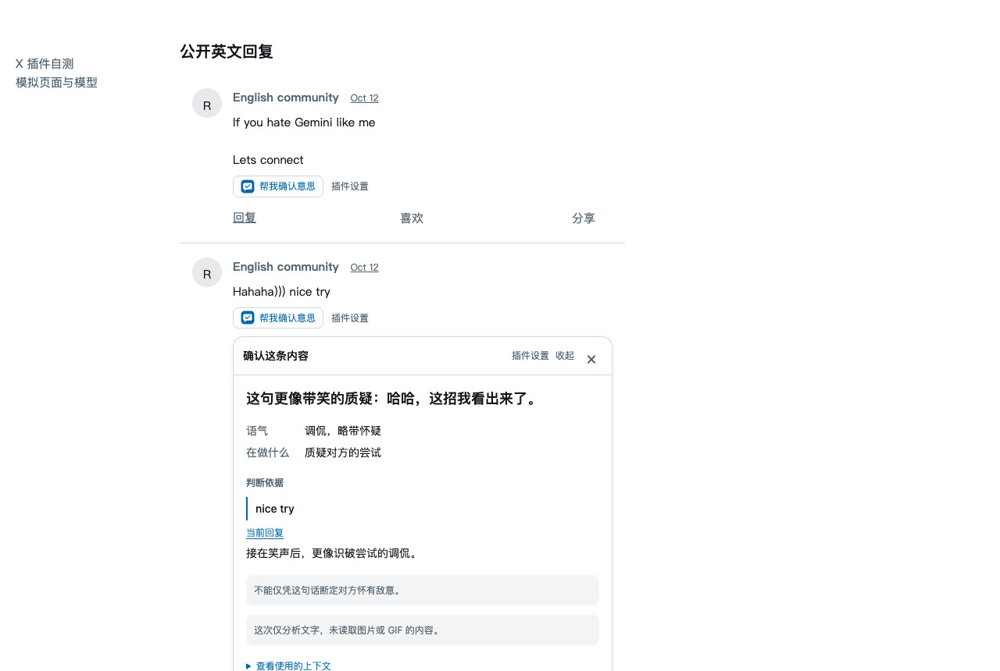

# Meaning Check

读懂公开帖子和回复的意思、语气与判断依据。使用自己的模型 API，在原文下点击「帮我确认意思」，解读就在对应内容下方展开。

**开源 · MIT · 自带 API（BYOK） · 中英界面**

[English](README.en.md) · [使用规则](documentation/product.md) · [模型与接口](documentation/models.md) · [验证记录](documentation/tests.md)

## 可以做什么

- 独立帖子直接解读当前文字；回复结合当前内容、直接父帖和原帖，来源相同则去重。
- 先给主解读，再看语气、表达功能和可回看的原文依据；不把反驳直接判成恶意，不虚构确定性百分比。
- 卡片在原文下方展开，可连续点击多条。最多两条并行，其余排队；滚动不关闭，收起继续，关闭只取消这一条。
- 加载、再次确认、手动分析和重试都有阶段、动效、秒数与等待上限。
- 自带模型 API：DeepSeek、Grok / xAI、GPT / OpenAI、Claude / Anthropic、Gemini、GLM、千问、Kimi、MiniMax，以及自定义兼容接口。
- 默认支持 X 和 Reddit；可管理网站与路径，其他已授权网站通过选中文字使用。界面和解读输出语言可分别设置。



截图来自实际插件的模拟网页 / 模型自测，用于展示交互，不代表真实模型质量。

## 安装与开始使用

当前为 **0.3.2 POC**，从源码构建安装；尚未发布扩展商店或正式 Release 安装包。

0.3.2 修复 X 时间线点击后只剩标题的空白卡片：原生图标不再中断帖子关系读取，卡片创建即显示准备状态，读取异常提供明确错误和主动重试。

需要 Node.js 24 和 pnpm 10：

```sh
git clone https://github.com/RexYoung000/Meaning_Check.git
cd Meaning_Check
pnpm install
pnpm build
```

1. 在 Dia / Chrome 地址栏打开 `chrome://extensions`，开启开发者模式，选择 **Load unpacked / 加载已解压的扩展程序**，选中项目的 `.output/chrome-mv3` 文件夹。
2. 点击工具栏插件图标 → **插件设置**，或网页内容旁的 **插件设置**。浏览器的 Details 是管理页，其中 **Extension options** 也能打开同一设置页。
3. 在 **模型连接**选择厂商、型号，输入自己的 API 密钥并保存。保存不会调用模型；点击测试连接会请求一次模型，可能产生 API 费用。
4. 在 **语言**设置界面与解读语言，在 **网站**管理生效范围。
5. 刷新 X / Reddit，点击「帮我确认意思」。自定义网站先选中文字，再确认可选背景并分析。

已有安装：构建更新后，在扩展管理页点 Reload，确认 0.3.2，再刷新网页。若浏览器加载的是另行解压的副本，需更新那个副本后再重载；单独修改源码文件夹不会自动更新它。保留原扩展路径 / ID，避免卸载后丢失本地配置。

## 「缺上下文」如何判断

这是页面关系与读取状态的判断，不是模型在猜有没有上下文：

- **已确认独立帖子**：父帖不适用，直接分析当前正文。
- **时间线未发现回复关联**：只解读本条，说明没有确认父帖不存在；可以补充背景。
- **已确认是回复，但父帖 / 原帖未取得**：先补齐，失败后由你选择现有文字、重试或手动补充。
- **关系尚未确认**：单独说明无法确认回复关系，不冒充已确认缺父帖。
- **正文未展开**：提示展开 / 补充文字。媒体、引用、隐藏控件和翻译按钮不算正文展开控件；再次分析会更新已选来源的文字和截断状态。

补齐最多 30 秒；一次执行总计最多 60 秒，排队不计入执行超时。上限不是预计完成时间。无效或未展开的输入会直接说明模型请求尚未开始，不用虚假等待掩盖错误。

## 模型、数据与边界

厂商名称、完整型号、API ID 与官方来源见 [模型目录](documentation/models.md)。保留 DeepSeek V4.1 Flash（`deepseek-flash`）和 Grok 4.6；目录是接口预置，实际可用型号取决于账号权限。Claude Code 是工具，不能用其登录凭据替代 Claude API 密钥。

密钥只保存在本浏览器扩展的可信本地存储，网页无法读取；只有你点击时，选中的相关文字才发送给当前配置的模型厂商。更换接口地址需要重新填写密钥。没有业务服务器、账号系统、分析历史、回复生成或自动发送；不会自动重发付费请求。

仅分析文字，图片 / GIF 不读取。模型引文必须匹配输入；无效依据和截断输出不展示为有效结论。此插件解释表达，不验证帖子中的新闻或事实。网站结构、登录状态和加载方式变化仍可能影响父链读取。

## 开发与验证

```sh
pnpm typecheck
pnpm test
pnpm build
pnpm exec playwright install chromium
pnpm test:e2e
pnpm check:package
```

`pnpm dev` 用于开发，`pnpm zip` 生成 `.output/meaning-check-0.3.2-chrome.zip`。图标维护源为 `public/icon.svg`，`pnpm icons` 输出 PNG；构建自动包含根 LICENSE。

测试使用独立临时浏览器配置和模拟接口，不使用个人浏览器资料。自动化通过不等于真实厂商质量通过；实际运行结果与尚待验收的项目见 [测试记录](documentation/tests.md)。

产品、交互、架构变更先更新对应文档，再实现。中文 README 与英文 README 同步维护；完成验证后同步公开仓库。普通代码同步不等于扩展商店发布。

## 文档与反馈

- [产品规则](documentation/product.md) · [交互设计](DESIGN.md)
- [架构与权限](documentation/architecture.md) · [模型目录](documentation/models.md)
- [验证和验收](documentation/tests.md) · [研究与反馈](documentation/research.md)

欢迎通过 [Issues](https://github.com/RexYoung000/Meaning_Check/issues) 提供公开页面案例、操作步骤与预期行为。请不要提交 API 密钥或私信内容。
